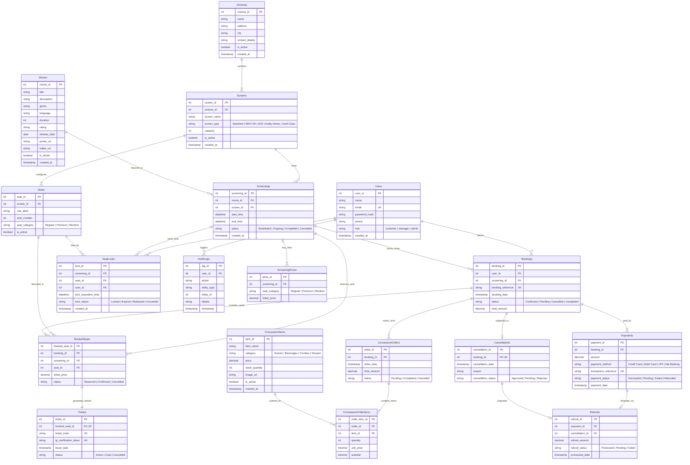

# Entity-Relationship (ER) Diagram & Schema Architecture
## Cinema Screening and Ticket Booking System (`CinemaBookingDB`)

---

## 1. Visual Entity-Relationship Diagram

---

## 2. Cardinality and Relationship Constraints

1. **Cinemas to Screens ($1 : N$):** One cinema contains multiple screens. Each screen belongs to exactly one cinema.
2. **Screens to Seats ($1 : N$):** One screen has multiple seats. A seat belongs to only one screen.
3. **Screenings to ScreeningPrices ($1 : N$):** Each screening specifies prices for each seat category (`Regular`, `Premium`, `Recliner`).
4. **Bookings to BookedSeats ($1 : N$):** A single customer booking reservation can contain multiple seats.
5. **BookedSeats to Tickets ($1 : 1$):** Each booked seat is issued exactly one e-ticket with a distinct QR verification token.
6. **Bookings to ConcessionOrders ($1 : 0..1$):** A booking may optionally include a concession order.
7. **ConcessionOrders to ConcessionOrderItems ($1 : N$):** An order itemizes $N$ concession products with quantity and unit price.
8. **Bookings to Payments ($1 : 1..N$):** Tracks initial payment transaction and any subsequent adjustments.
9. **Bookings to Cancellations ($1 : 0..1$):** A booking may be cancelled at most once.
10. **Payments to Refunds ($1 : 0..1$):** A payment may generate a refund following an approved cancellation.
11. **SeatLocks Concurrency ($M : N$ with TTL):** Prevents simultaneous seat booking race conditions with automatic time-to-live locks.
